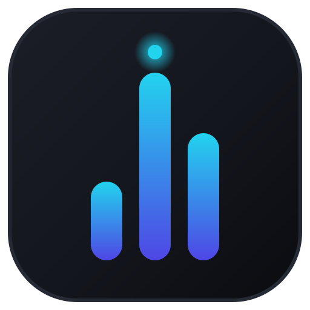

<p align="center">
  
</p>

<h1 align="center">AIRA</h1>

<p align="center">
  <strong>An AI that investigates reality before you make a decision.</strong><br/>
  Paste a brief. AIRA calls everyone, verifies answers, and hands you a ranked, evidence-backed decision.
</p>

---

## Two ways to run it

| | Desktop (primary) | Web (fallback) |
|---|---|---|
| Install | `AIRA-Setup.exe` installer | `npm install` |
| Launch | Start menu / `AIRA.exe` | `npm run dev` → http://localhost:3000 |
| Database | Auto-created SQLite in `%APPDATA%\AIRA` | Local SQLite file (`prisma/dev.db`) |
| Keys | In-app Settings (gear icon) | `.env` (copy `.env.example`) |
| Docker | ❌ never needed | ❌ **not needed either** — the web app runs on the same embedded SQLite |

Both modes share the same code, UI, and data layer. Pick desktop for daily use; the web mode exists so nothing is lost if the packaged app isn't an option.

## Quickstart — Desktop

```bash
npm install
npm run desktop:build     # -> dist-desktop/AIRA-Setup-<version>.exe
```

Install, launch, click the gear icon, paste your Gemini/LiveKit/Twilio keys, Save & apply.
First run creates everything automatically — no database setup, no config files.

## Quickstart — Web (no Docker)

```bash
npm install
npm run db:migrate        # creates prisma/dev.db (SQLite)
npm run db:seed           # optional: realistic demo data with playable recordings
npm run dev               # http://localhost:3000
```

Set `DATABASE_URL="file:./prisma/dev.db"` in `.env` (or inline) for the server process.
Voice calls still need LiveKit/Twilio keys in `.env`; parsing needs `GEMINI_API_KEY`.

## What it does

1. **Intake** — paste a freeform brief ("PG in Koramangala under 15k, these 3 numbers, ask about deposit"). Gemini + regex extract requirement, contacts, languages (never invents numbers).
2. **Review** — edit anything the AI misheard before launch.
3. **Calls** — LiveKit SIP + Twilio place real calls; a Gemini Realtime voice agent converses in the contact's language, ≤3 calls in parallel, retries with backoff.
4. **Live Ops** — transcripts stream in live (agent in indigo, human in amber), durations tick, recordings start.
5. **Decision Brief** — every call becomes structured findings (price, availability, fit, constraints); options ranked with arc-gauge scores, inline transcripts, playable recordings, and next moves.

## Architecture

```
┌──────────────────────── Electron main ────────────────────────┐
│ window · splash · settings IPC · first-run SQLite bootstrap    │
│ spawns ↓ on a free localhost port, kills it on quit           │
└───────────────────────────┬───────────────────────────────────┘
                  Next.js standalone server (Node)
                             │
   ┌─────────────┬──────────┴─────────┬──────────────────────┐
   │ Intake      │ Orchestrator       │ Analysis             │
   │ Gemini parse│ p-limit(≤3) calls  │ scoring + ranking    │
   │ regex phones│ retry ×3 backoff   │ action items         │
   └─────────────┴─────────┬──────────┴──────────────────────┘
                           │
        LiveKit SIP/Twilio PSTN ←→ Gemini Realtime voice agent worker
                           │
              SSE event stream ← live transcripts/recordings
                           │
        SQLite (desktop: %APPDATA%/AIRA · web: prisma/dev.db)
```

## Where your data lives

| What | Desktop | Web dev |
|---|---|---|
| Database | `%APPDATA%\AIRA\data\aira.db` | `prisma/dev.db` |
| Recordings | `%APPDATA%\AIRA\data\recordings\` | `.aira-recordings\` |
| Server log | `%APPDATA%\AIRA\data\server.log` | terminal |
| Settings/keys | `%APPDATA%\AIRA\settings.json` | `.env` |

Nothing syncs anywhere. Delete the file, delete the history.

## Scripts

| Script | What it does |
|---|---|
| `desktop:dev` | Electron window + Next dev server together |
| `desktop:build` | Production build + NSIS installer (with AIRA icon) |
| `dev` | Web-only dev server |
| `test` | Vitest unit suite |
| `db:generate` / `db:migrate` / `db:seed` | Prisma client / SQLite migrations / demo seed |
| `native:node` | Swap better-sqlite3 back to Node ABI after packaging |

## Roadmap

AIRA is deliberately built as the foundation of something bigger — an **investigation agent**, not a voice bot. The full thesis lives in [VISION.md](./VISION.md); the short version:

| Horizon | Ships |
|---|---|
| **Now** | Desktop app, local-first SQLite, editable review, Live Ops controls, decision briefs with evidence |
| **Near** | Evidence graph (claims + sources + confidence), Unknowns tracking with auto follow-up loops, multi-source intake (URLs, PDFs, screenshots) |
| **Mid** | Truth/Verification Engine (cross-source contradiction detection), Negotiation within user-set guardrails, approval checkpoints |
| **Far** | WhatsApp channel, contact self-discovery, price intelligence, Vendor Trust Scores, autonomy levels 1→5 |

The moat: persistent investigation memory — what vendors said, promised, and how reliable they proved — compounding across every run.

## License

Private project. All rights reserved.
